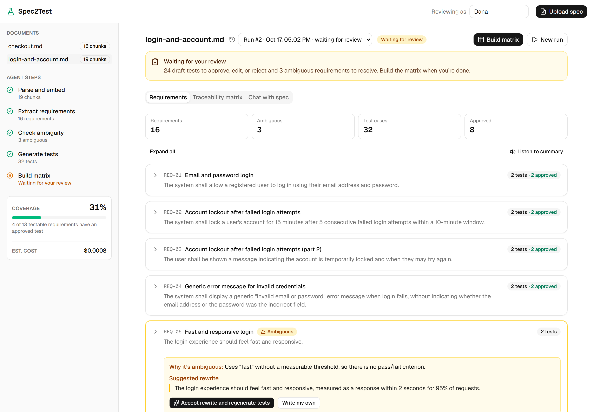
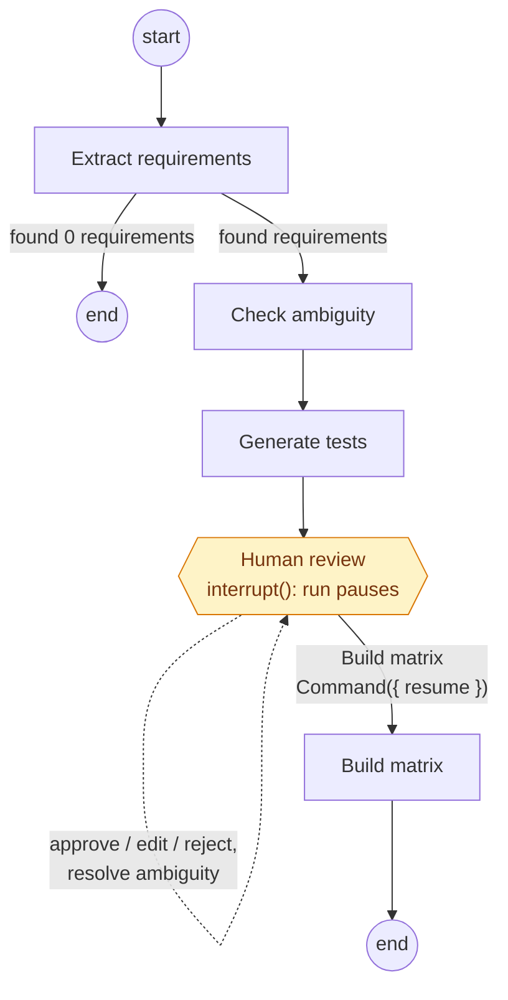

# Spec2Test

**Turn software requirements into reviewed, traceable test cases with AI agents.**

[](https://github.com/chrisel2002/Spec2Test/actions/workflows/ci.yml)
[](LICENSE)

**Live demo: [spec2test.onrender.com](https://spec2test.onrender.com)**. It runs on a free host that sleeps when idle, so the first page can take up to a minute to load. The demo shows two sample specs with finished, reviewed runs; uploading and running the agents need an access code ([why](#demo-mode)).

<!-- GIF of the full flow (upload → live agent steps → review → matrix → export) goes here: docs/images/demo.gif -->


## What it does

You upload a requirements document (PDF or Markdown). A LangGraph agent pipeline extracts atomic requirements, flags the ambiguous or untestable ones with a suggested rewrite, and drafts Given/When/Then test cases for each. The run then pauses: a person approves, edits, or rejects every test, and only then is the traceability matrix built. The result exports as CSV, Playwright test skeletons, or a Markdown report, and the same tools are available to AI agents through an MCP server.

### Key features

- **Agent pipeline** with live progress in the browser ("Generating tests 5/12"), streamed over server-sent events
- **Ambiguity detection**: vague requirements are flagged with a reason and a measurable rewrite, which the reviewer can accept or replace
- **Human-in-the-loop checkpoint**: a real LangGraph `interrupt()`, persisted in Postgres; coverage counts approved tests only, and every review decision is logged
- **Traceability matrix** with gaps highlighted, run history, and retry from the failed step
- **Exports**: CSV, Playwright `.spec.ts` skeletons (zip), Markdown report
- **MCP server** for Claude Code and other agents, deliberately without any tool that approves tests
- **Evaluation harness**: deterministic metrics against hand-written golden answers, gating CI
- **Insights page**: cost, tokens and time per run and step, eval scores, reviewer approval rates
- **Chat with the spec** (retrieval with citations) and optional **voice** output (ElevenLabs)
- **Hardened**: prompt-injection fencing, upload checks by content, rate limits, access-code demo mode

## Architecture

Two front doors, the web app and the MCP server, share one service layer. Routes and MCP tools only translate input and output; the services do the work.


### The agent pipeline

Uploading a spec parses, chunks and embeds it. **Run agent** then runs this graph over the document's chunks:



- **Extract requirements** splits compound requirements apart; each must cite the chunk(s) it came from.
- **Check ambiguity** looks for vague wording, missing thresholds and undefined terms, and proposes a measurable rewrite.
- **Generate tests** writes 2–4 Given/When/Then cases per requirement (from the rewrite, for ambiguous ones).
- **Human review** pauses the run with its state checkpointed in Postgres, for as long as review takes.
- **Build matrix** snapshots coverage on the run, which becomes a read-only, signed-off record.

Each step records its status, tokens and estimated cost in `agent_runs`.

**Live progress.** A run executes in the background (Next.js `after()`), not inside the request that started it. Nodes emit Zod-validated events through LangGraph's custom stream mode; the runner relays them to an in-process event bus, and `GET /api/runs/:id/events` sends each browser a database snapshot followed by live events. Every event carries full rows, so applying one twice is harmless, which makes reconnecting after a refresh safe.

**Coverage** = testable requirements with at least one approved test ÷ all testable requirements. Unresolved ambiguous requirements count as gaps; draft and rejected tests don't count.

## Tech stack

| Area | Choice |
|---|---|
| App | Next.js 16 (App Router), TypeScript strict |
| UI | Tailwind CSS, shadcn/ui |
| Validation | Zod for inputs, API payloads and every structured LLM output |
| Data | PostgreSQL + pgvector, Drizzle ORM |
| AI | Vercel AI SDK, LangGraph.js (Postgres checkpointer); provider set by env (Gemini by default, OpenAI or Anthropic) |
| Testing | Vitest, Playwright, an eval runner in `evals/` |
| Infra | Docker, GitHub Actions, Render (free web service), Neon (free Postgres) |

## Quickstart

Needs Node 20+, Docker, and Git. pnpm comes from Corepack.

```bash
git clone https://github.com/chrisel2002/Spec2Test.git
cd Spec2Test
corepack enable
cp .env.example .env.local
```

Then choose a model in `.env.local`:

- **Real model (free):** get a Gemini API key at [aistudio.google.com/apikey](https://aistudio.google.com/apikey) and set `GOOGLE_GENERATIVE_AI_API_KEY=`.
- **No key at all:** set `MODEL_PROVIDER=mock` and `EMBEDDING_PROVIDER=mock`. A deterministic stand-in model runs the whole pipeline offline; chat needs a real model.

```bash
docker compose up -d     # Postgres 16 with pgvector
pnpm install             # also compiles the MCP server
pnpm db:migrate
pnpm dev
```

Open [localhost:3000](http://localhost:3000), upload `sample-specs/checkout-spec.md`, and click **Run agent**. [localhost:3000/api/health](http://localhost:3000/api/health) checks the database connection.

### Commands

```
pnpm dev                start the app
pnpm lint               lint and type-check
pnpm test               unit tests (no database or API key)
pnpm test:coverage      unit tests with coverage of src/lib/ (fails below the minimums)
pnpm test:e2e           Playwright, against its own spec2test_e2e database and the mock model
pnpm test:mcp           MCP server tests, against spec2test_mcp and the mock model
pnpm test:integration   tests against a real database and embedding API (needs .env.local)
pnpm eval:mock          evals on the mock model, checked against the CI thresholds
pnpm eval               evals on the real model from .env.local (about 30 calls per spec)
pnpm knip               unused files, exports and dependencies
pnpm db:generate        new Drizzle migration after a schema change
pnpm db:migrate         apply migrations to the local database
pnpm db:migrate:prod    apply migrations to production (see Deployment)
pnpm db:seed-demo       copy the sample runs to production (see Deployment)
pnpm mcp:build          rebuild the MCP server after changing src/
```

## Evaluation

Each sample spec has a hand-written golden file in [`evals/golden/`](evals/golden/): the requirements a good run should extract (including how compound ones split), which are ambiguous and why, and the boundary values good tests should cover.

### Latest results

Real model `gemini-flash-lite-latest`, prompts v3 ([`evals/results/`](evals/results/)):

| Metric | Login spec | Checkout spec |
|---|---|---|
| Requirement recall | 100% (18/18) | 100% (16/16) |
| Requirement precision | 100% | 100% |
| Ambiguity precision | 100% | 100% |
| Ambiguity recall | 100% (3/3) | 100% (3/3) |
| Boundary coverage | 100% (3/3) | 100% (2/2) |
| Grounding | 100% | 100% |
| Schema validity (first try) | 100% (15 calls) | 100% (15 calls) |
| Tokens | 13,314 | 12,158 |
| Estimated cost | $0.0011 | $0.0010 |
| Run time | 27.6 s | 19.9 s |

Cost is at paid-tier rates (the free tier costs nothing); run time is mostly waiting out free-tier rate limits. What the run history shows:

- **Prompts v1 flagged a testable requirement as ambiguous** (REQ-CO-13, an estimated delivery date whose calculation isn't specified): 75% ambiguity precision. v2 added one rule (unspecified implementation is fine if the behaviour has a pass/fail outcome), and `pnpm eval -- --compare` showed precision at 100% with recall unchanged, for +667 tokens per spec.
- **Boundary coverage varies.** In 5 checkout runs since v2, tests missed the €50.00 delivery threshold once. Test generation is the least deterministic step; the next prompt change to try is an explicit at-and-just-past-the-limit rule, measured over several runs.
- **These specs are easy.** Two short synthetic specs written together with their golden answers are a regression check, not proof on messy real documents. The reviewer approval rate on the Insights page is the real-world signal.

The prompt-injection spec ([`evals/adversarial/injection-spec.md`](evals/adversarial/injection-spec.md)) also scores 100%: only real requirements extracted, the ambiguous one still flagged although the spec says it's clear, and no planted text in the output.

### How the metrics work

| Metric | Calculation |
|---|---|
| Requirement recall / precision | Golden requirements matched ÷ all golden; matched extractions ÷ all extracted (invented or wrongly split ones lower it). |
| Ambiguity precision / recall | On matched requirements: correct flags ÷ all flags; correct flags ÷ all golden ambiguous (unextracted ones count as missed). |
| Boundary coverage | Golden boundary values mentioned in a test **of the requirement they belong to** ÷ all boundary values. |
| Grounding | Requirements citing a real source chunk ÷ everything the model returned. |
| Schema validity | Model calls whose first response passed its Zod schema ÷ all calls. |

**Matching:** each golden requirement lists term groups (REQ-LA-02 needs `lock`, `15` and `5`); an extracted requirement matches if it contains an alternative from every group, at the start of a word. Pairs are then assigned one-to-one by maximum bipartite matching, so one extraction can't count twice. **Boundaries** are regexes with examples and counter-examples checked by unit tests. Two deliberate choices: for the quantity range 1–10 only 0, 10 and 11 count (quantity 1 appears in almost every cart test, so it proves nothing), and REQ-CO-07 ("not too many steps") is kept as an intentionally hard ambiguity that the real model catches and the mock misses.

**In CI**, `pnpm eval:mock` fails the build if any metric drops below [`evals/thresholds.ts`](evals/thresholds.ts) or any output contains planted text. The mock is deterministic, so a drop means code broke the pipeline; thresholds sit just under its known blind spots (no compound splitting, 94% recall; misses REQ-CO-07). Real-model evals stay manual because of the free quota.

## Security

- **Prompt injection.** Spec text is fenced in named tags (`<document_excerpt>`, `<requirement>`, `<excerpt>`) that every system prompt declares untrusted, and our tag names inside a spec are escaped so it can't close the fence. The model has no tools and answers only through length-capped Zod schemas, and nothing reaches the matrix without human approval. The adversarial spec plants three attacks; unit tests check the fencing and the eval checks real output.
- **Uploads** are checked by content, not just extension (`%PDF-` header, UTF-8 Markdown, renamed binaries named as what they are), with limits of 10 MB and 50 PDF pages, and clear errors for empty, damaged, encrypted or image-only PDFs.
- **Rate limits** on everything that spends quota: per client and global sliding windows (for example 5 runs per 10 minutes per client, 10 per hour in total), returning 429 with `Retry-After`. In memory, per process: an accident guard, not an abuse defence.
- **Access code** for the public demo (below), compared in constant time and rate-limited against guessing.
- **Secrets stay on the server.** Keys are read only in `server-only` modules (no `NEXT_PUBLIC_` variables), the production browser bundles contain no key names or values, and errors are translated to safe messages before leaving the server. Production secrets live only in Render's dashboard; the history contains no `.env` files or keys.

## Deployment

The live demo is a Docker image ([`Dockerfile`](Dockerfile), Next.js standalone output, non-root, about 100 MB of memory under load) on Render's free web service in Frankfurt, defined in [`render.yaml`](render.yaml), with a free Neon Postgres database. Render deploys a commit to `main` only after CI passes.

- **Migrations** run from a laptop, not on container start: `pnpm db:migrate:prod` reads Neon's direct (non-pooled) connection string from `.env.production.local`, enables pgvector, applies the Drizzle migrations and creates the checkpointer tables. The app itself uses the pooled string.
- **Secrets** (`DATABASE_URL`, `GOOGLE_GENERATIVE_AI_API_KEY`, `ELEVENLABS_API_KEY`, `ACCESS_CODE`) are marked `sync: false` in `render.yaml`, so Render asks for them in its dashboard; no value is in the repo or the image.
- **Demo data:** `pnpm db:seed-demo` copies each sample spec's latest completed run from the local database to Neon. It selects documents by the SHA-256 of the files in `sample-specs/`, so nothing else from a local database can be published.

### Demo mode

Every visitor can browse the seeded runs: requirements, ambiguity flags, reviewed tests, the matrix, exports and Insights, all read from the database without a single model call. Anything that spends API quota or changes the shared data (upload, running or retrying the agent, review, chat, voice) needs an access code when `ACCESS_CODE` is set. The code is checked in constant time; a correct one sets an httpOnly cookie holding an HMAC of the code (not the code), and the UI shows a dialog explaining how to get one instead of failing. Without `ACCESS_CODE`, as in local development, nothing is gated.

## Design decisions

### A graph of focused nodes, not one big prompt

Each node does one job with its own narrow prompt and Zod schema. One "spec in, tests out" prompt holds three jobs' instructions at once, does each less well, and can't explain why a requirement got a test. Separate nodes also fail visibly (`agent_runs` shows which step broke) and can be improved independently.

### The agent pauses for human review

LLM-written tests are drafts: some miss the point, some assert things the spec never said, and tests for an ambiguous requirement rest on a guess. A matrix built from them would claim coverage nobody checked, which is worse than no number. So the graph stops after test generation, a person signs off each test and ambiguity, and coverage counts approved tests only.

The pause is a LangGraph `interrupt()` with a Postgres checkpointer rather than two separate runs: the run keeps one history, the pause survives restarts and redeploys, and the same checkpoints let a failed run retry from the step that failed. In-memory `MemorySaver` would lose every paused run on restart.

### The MCP server can't bypass review

An agent over MCP can ingest, run, read the flags, and read and export the matrix, but no tool approves, edits or rejects a test or builds the matrix. A paused run returns `waiting_for_review` with the review URL and a `nextAction` telling the agent to hand it to the user. A missing tool is stronger than a permission check: an agent can't call what doesn't exist, however it's prompted. The service layer enforces the same rule underneath (exports refuse a run that isn't signed off).

### One service layer for both interfaces

If the web app and the MCP server each had their own logic, they'd drift: a missing "is a run already in progress?" check here, slightly different coverage there. Every action lives once in `src/lib/services/`; adapters parse input, call a service and map its `ServiceError` kind (`invalid`, `not_found`, `conflict`, `rate_limited`) to HTTP or MCP. Differences like scheduling background work (`after()` vs a plain promise) are passed in. Two processes running the agent also exposed a bug: "is this run alive?" can't mean "is this process running it?", so liveness became a heartbeat in the database.

### Server-sent events, not the AI SDK's chat stream

The AI SDK's UI stream is shaped for chat messages tied to one request. Agent progress is a one-way feed of typed pipeline events with no LLM text, which plain SSE fits: a `ReadableStream` on the server, the browser's auto-reconnecting `EventSource`, and one Zod event union shared by both. The run is decoupled from the connection, so closing the tab doesn't stop it.

### What happens to a run when the free host sleeps or restarts

Runs execute inside the web server process, and Render's free instance sleeps after 15 minutes without requests, may restart at any time, and is replaced on every deploy. Each case was tested by stopping or killing the production container mid-run:

- **Sleep.** Starting a run is a request, and a run takes one to three minutes, well inside the idle window. A run waiting for review needs no process: its state is a checkpoint in Postgres, so the instance can sleep for days and **Build matrix** still resumes it.
- **Graceful restart or deploy.** Render sends SIGTERM and waits up to `maxShutdownDelaySeconds` (120 s here). Next.js stops taking requests but finishes pending `after()` work, where runs execute, so a run in progress completes.
- **Hard kill or crash.** The heartbeat stops; 30 s later the run shows as failed ("the process running it restarted") with **Retry**, which continues from the last checkpoint without repeating finished steps.

That guarantee needed one fix: LangGraph saves checkpoints asynchronously by default, while the next step already runs, so a kill right after a step lost it and Retry repeated (and paid for) that step. Runs now use `durability: "sync"`: one extra database write per step.

### Deterministic metrics, not an LLM judge

Grading with another LLM adds the judge's noise to the agent's, can't say what to fix, costs quota, and tends to prefer its own phrasing. Code-computed metrics against golden files give the same score for the same output, trace every point to a specific miss, and are free enough to gate every CI build. The cost is hand-written golden files and term matching that could miss an unexpected wording; tests on the golden files and the saved match details keep that visible.

### Every LLM output goes through a Zod schema

`generateObject()` validates output before our code sees it, so a malformed response is retried and then fails loudly instead of putting a broken requirement in the database. Schemas also encode rules: `sourceChunkRefs.min(1)` makes an ungrounded requirement invalid, and a `.refine()` makes "ambiguous with no reason" impossible.

### Chunking

Two passes (`src/lib/ingest/chunk.ts`): split at every heading, then split sections over 800 characters into ~800-character pieces with 100 characters of overlap, cut at whitespace. Small enough that a chunk is one topic, which keeps chat citations precise; large enough to embed meaningfully without flooding retrieval with fragments. The overlap keeps a sentence at a cut point whole in at least one chunk.

### pgvector, not a separate vector database

The dataset is hundreds to thousands of chunks. pgvector's HNSW index (the same algorithm most vector databases use) is plenty, and keeping vectors beside the relational data means one database to run, foreign-key cascades from documents to chunks, and one `docker compose up`. At tens of millions of vectors this would be worth revisiting.

### Voice is generated server-side and cached

The browser posts text to `/api/voice`; the server calls ElevenLabs with its own key and enforces a 1,000-character cap, so the key never reaches a visitor. Audio is cached in Postgres by SHA-256 of text, voice and model, since ElevenLabs bills per character and summaries are replayed; a disk cache would vanish with every container restart. Without `ELEVENLABS_API_KEY`, voice is simply off.

## Limitations and next steps

- **Single instance.** The live-progress event bus and the rate-limit counters are in memory, which is right for one free instance but wrong for several. Scaling out would move events to Postgres `LISTEN/NOTIFY` or Redis pub/sub and the counters to a shared store (the heartbeat already lets instances agree on which runs are alive).
- **Free tiers.** The first request after 15 idle minutes waits up to a minute for the instance to wake, and Neon adds a short cold start after 5 idle minutes. Gemini's free quota allows only a few runs per hour, which is why the demo is gated and the rate limits are tight.
- **Shared demo data.** Everyone with the code sees and edits the same documents; real use would need accounts and per-user data.
- **Production setup.** On Google Cloud Run the same image would get a minimum instance (no cold starts), Secret Manager, Cloud SQL or a paid Neon plan, and a job queue (Cloud Tasks) so runs don't depend on the web process staying alive.
- **Evaluation depth.** Two synthetic specs are a regression check. Next: messier public specs in the golden set, and repeated runs per spec to measure variance, not just one score.

## Use Spec2Test from Claude Code (MCP)

The MCP server runs locally over stdio, with the same database and `.env.local` as the web app. `pnpm install` compiles it to `dist/mcp/main.mjs`; after changing `src/`, run `pnpm mcp:build`.

The repo's `.mcp.json` registers it for this project: run `claude` in the repo and approve `spec2test`. To use it from any directory:

```bash
claude mcp add --scope user spec2test -- node /path/to/Spec2Test/dist/mcp/main.mjs
```

`claude mcp list` should show `✔ Connected`. Postgres must be running, and the web app too for the review step. (It's compiled because cold-starting the TypeScript through `tsx` took long enough to hit Claude Code's 30-second connection timeout; the bundle starts in about 2 s.)

**Tools:** `list_documents`, `ingest_spec`, `start_run`, `get_run_status`, `get_requirements` (with ambiguity flags), `get_traceability_matrix` (with coverage and gaps), `export_playwright_tests`.

> **You:** Ingest sample-specs/login-account-spec.md, start a run, and tell me which requirements are ambiguous.
>
> **Claude:** *(calls `ingest_spec`, `start_run`, polls `get_run_status`, then `get_requirements` with `ambiguousOnly`)* The run extracted 18 requirements and drafted 37 test cases, and is waiting for review. Three are ambiguous:
>
> | Code | Requirement | Why | Suggested rewrite |
> |---|---|---|---|
> | REQ-09 | Registration should be quick and easy for new users. | "Quick" and "easy" have no measurable threshold | Registration completes within 30 seconds of submitting the form |
> | REQ-16 | The system should be secure against common attacks. | "Common attacks" isn't defined | Block every attack in the OWASP Top 10 categories |
> | REQ-18 | User sessions should time out after a reasonable period of inactivity. | "A reasonable period" has no duration | End a session after 30 minutes of inactivity |
>
> I can't approve the test cases: Spec2Test only counts tests a person has signed off. Review them at http://localhost:3000/?run=59dcbd9d-… and click **Build matrix**; then I can export Playwright tests for the approved ones.

The run and the three requirements are real tool output with `gemini-flash-lite-latest`; Claude's wording around them is condensed.

## License

[MIT](LICENSE)
