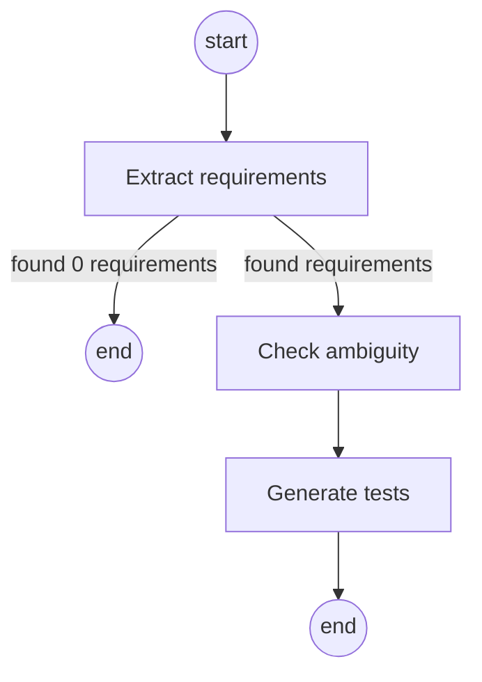

# Spec2Test

Turn software requirements into test cases with AI agents.

**[Demo GIF placeholder — add once the upload → test case flow works end to end]**

## Tech stack

- **App:** Next.js (App Router) with TypeScript in strict mode
- **UI:** Tailwind CSS + shadcn/ui
- **Validation:** Zod for all inputs, API payloads, and LLM structured outputs
- **Database:** PostgreSQL with the pgvector extension, accessed through Drizzle ORM
- **AI:** Vercel AI SDK for model calls, streaming, and tool calling; LangGraph.js for the agent graph
- **Testing:** Vitest for unit tests, Playwright for end-to-end tests, plus an eval script in `evals/`
- **Infrastructure:** Docker Compose for local development, GitHub Actions for CI, GCP Cloud Run for deployment
- **Package manager:** pnpm

## Running locally

1. Copy the environment template and fill in real values:
   ```
   cp .env.example .env.local
   ```
2. Start PostgreSQL with pgvector:
   ```
   docker compose up -d
   ```
3. Install dependencies and apply database migrations:
   ```
   pnpm install
   pnpm db:migrate
   ```
4. Start the dev server:
   ```
   pnpm dev
   ```
5. Check everything is wired up at [http://localhost:3000/api/health](http://localhost:3000/api/health).

### Other commands

```
pnpm test               run unit tests (no DB or API key needed)
pnpm test:integration   run tests against a real DB + embedding API (needs .env.local)
pnpm test:e2e           run Playwright tests
pnpm eval               run the eval script
pnpm db:generate        generate a new Drizzle migration after changing the schema
pnpm lint               lint and type-check
```

## Architecture

Uploading a spec runs it through parsing → chunking → embedding (see the
chunking design decision below). Clicking **Generate tests** on a document
then runs a separate, three-node LangGraph.js pipeline over that document's
chunks:



- **Extract requirements** reads the document's chunks and pulls out
  atomic, testable requirements, splitting compound ones ("shall do A and
  B") apart. Every requirement must cite which chunk(s) it came from.
- **Check ambiguity** reviews each requirement's own text for vague
  wording, missing thresholds, or undefined terms, and — only when it
  finds a problem — proposes a measurable rewrite.
- **Generate tests** writes 2-4 Given/When/Then test cases per
  requirement (from the rewrite, for ambiguous ones), covering at least
  one positive and, where it makes sense, one negative/boundary case.

If extraction finds zero requirements, the graph ends right there instead
of running ambiguity checks and test generation over nothing. Each node
records its own status, token usage, and estimated cost to `agent_runs`
before handing off to the next one (`src/lib/agents/`).

## Design decisions

### Why a graph of focused nodes instead of one big prompt

Each node does exactly one job — extract, judge testability, or write
tests — with its own narrow prompt and its own Zod schema. A single
"read this spec and produce requirements with tests" prompt would have to
hold all three jobs' instructions and output shapes in its head at once,
which tends to produce shallower results on every sub-task as the prompt
grows, and makes "why did this requirement get this test?" unanswerable
(the model made every decision in one undifferentiated pass). Separate
nodes also fail independently and visibly — `agent_runs` shows exactly
which step broke, not just "the pipeline failed somewhere" — and each
step's prompt and schema can be improved without touching the other two.

### Why every output goes through a Zod schema

An LLM asked for free-text JSON will occasionally hand back malformed
JSON, miss a field, or invent one — not often, but at the batch counts
this pipeline runs over free-tier rate limits, often enough to matter.
`generateObject()` validates the model's output against a Zod schema
before any of our code sees it, so a bad response surfaces immediately as
a validation error (retried, then failed loudly) instead of silently
propagating a malformed requirement or test case into the database. The
schemas also do more than type-check: `sourceChunkRefs.min(1)` makes an
ungrounded requirement a schema violation rather than a prompt
suggestion, and `AmbiguityResultSchema`'s `.refine()` makes "ambiguous
with no reason" structurally impossible to return.

### Chunking strategy

Chunking happens in two passes (`src/lib/ingest/chunk.ts`). First, the
document is split by heading — every `#`/`##`/`###` (or, for PDFs, every
detected heading) starts a new section, so a section is never larger than
the text between two headings. Second, any section still longer than
**800 characters** (roughly 150–200 tokens) is split further into
~800-char pieces with **100 characters (~12%) of overlap**, snapping each
cut to the nearest whitespace so words aren't broken mid-token.

800/100 was chosen as a balance: small enough that a chunk stays about one
topic, which matters because the chat UI cites the exact chunk an answer
came from — a chunk spanning three unrelated requirements would make a
citation misleading. Large enough that retrieval isn't flooded with
hundreds of near-duplicate fragments, and that each chunk carries enough
surrounding context to be a sensible embedding input on its own. The
overlap exists so a sentence that happens to fall right at a split point
still appears in full in at least one chunk, instead of being cut in half
and missed by both.

In practice, most sections in our sample specs (one requirement per
heading) are well under 800 characters, so they usually end up as exactly
one chunk each — the size-based splitting mostly matters for longer
free-text sections rather than our requirement-style documents.

### Why pgvector instead of a separate vector database

The whole dataset for this project is a handful of uploaded specs —
hundreds to low thousands of chunks, not millions. At that scale, a
dedicated vector database (Pinecone, Weaviate, Qdrant, …) adds an extra
service to run, pay for, and keep in sync with Postgres, without a
performance benefit pgvector doesn't already provide (we use an HNSW
index with cosine distance, which is the same algorithm most dedicated
vector DBs use under the hood).

Keeping embeddings in the same Postgres database as `documents`,
`requirements`, and `test_cases` also means a single transaction can
touch both relational and vector data — e.g. deleting a document cascades
to its chunks automatically via a foreign key — and local dev only needs
one `docker compose up` instead of standing up a second service. The
trade-off is that pgvector wouldn't be the right call at a much larger
scale (tens of millions of vectors, or needing features like serverless
auto-scaling of the index) — but that's not this project.
